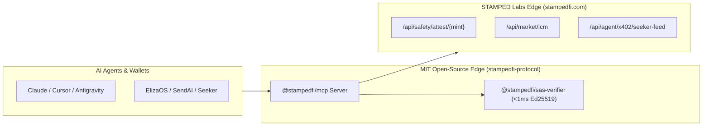

# StampedFi Trust & Signal Protocol (`stampedfi-protocol`)

[](https://github.com/AbsCodeX/stampedfi-protocol/actions/workflows/ci.yml)
[](./LICENSE)

| Executive Field | Verified Specification |
| :--- | :--- |
| **Issuer & Maintainer** | **STAMPED Labs, Inc.** · Founder & Managing Director: Abigail Stafford (`founders@stampedfi.com`) |
| **License & IP Boundary** | `MIT` Public Goods SDK & MCP Server (Zero proprietary backend scoring rules or routing weights) |
| **Packages** | `@stampedfi/sas-verifier` ([src/index.ts](./packages/sas-verifier/src/index.ts)) · `@stampedfi/mcp` ([src/index.ts](./packages/stampedfi-mcp/src/index.ts)) |
| **Supported Schemas** | `stamped-sas-v1` · `stamped-tier-v1` · `stamped-sgt-v1` · `x402-v1` |
| **Solana Stack** | `@solana/kit` `8.6.0` · `@modelcontextprotocol/sdk` `1.32.2` · `tweetnacl` Ed25519 (`<1ms` offline) |

**Quick Navigation:**
[1. Architecture Flow](#sec-1) · [2. Package Matrix](#sec-2) · [3. MCP Agent Tools](#sec-3) · [4. Build & Test Commands](#sec-4)

---

<a id="sec-1"></a>

## 1. Architecture Flow



---

<a id="sec-2"></a>

## 2. Package Matrix

| Package | Version | Core Exports | Primary Use Case |
| :--- | :---: | :--- | :--- |
| **`@stampedfi/sas-verifier`** | `0.1.0` | `verifySignedSafetyAttestation`, `verifySignedTierReceipt`, `verifySignedSgtReceipt`, `guardSolanaBlinkUrl` | Pure offline `<1ms` Ed25519 + SHA-256 verification for wallets, Blinks, and bots |
| **`@stampedfi/mcp`** | `0.1.0` | `createStampedMcpServer`, `createStampedMcpTools`, `computeStampShieldAuto2x` | Plug-and-play MCP server (`stdio`) for AI agents to screen tokens and fetch Seeker theses |

---

<a id="sec-3"></a>

## 3. MCP Agent Tools

| Tool Name | Input Parameters | Verified Output |
| :--- | :--- | :--- |
| `stamped_verify_token_safety` | `mint` (Base58) | Cryptographically verified `stamped-sas-v1` verdict (`ok`, `caution`, `risky`, `blocked`) + risk flags |
| `stamped_get_icm_assets` | `category` (`all`, `equity`, `prediction`, `yield`, `depin`) | Curated Sunrise `$SPCX`, `xStocks`, Kalshi x DFlow, Lulo USDC, Sanctum `INF`, and Helium `HNT` cards |
| `stamped_get_verified_theses` | `paymentProofSignature?`, `preview` | `x402-v1` Solana Mainnet USDC (`$0.01`) settled Seeker & ICM signals |
| `stamped_verify_holder_tier` | `receiptJson`, `expectedIssuerPubkey?` | Offline Zero-Dox conviction proof (`Shrimp`, `Dolphin`, `Shark`, `Whale`) without wallet exposure |
| `stamped_compute_stamp_shield` | `entryTokenUnits`, `decimals`, `entryPriceUsd` | Deterministic `bigint` **Stamp Shield (Auto-2x House Money)** exit plan |

---

<a id="sec-4"></a>

## 4. Build & Test Commands

```bash
npm run build
npm test
```
